# Penetration Testing Report: Footprinting & Network Scanning Phases

**Cybersecurity | Networkwalks**  
**Intern ID:** [NW-084-1F7]

**Full report:** [Penetration Testing Report (PDF)](https://drive.google.com/file/d/15N5_TQWnOntjfuhV1vciV7zvsPYSScry/view?usp=drivesdk)  
**Letter of Authorization:** [Letter of Authorization (PDF)]()


| Field | Detail |
|---|---|
| Pentester Name (Cybersecurity Professional) | Ozaraebuka Ifechukwu Divine |
| Program/Batch | B084-Networkwalks |
| Date | 13 November 2026 |
| Modules completed | Footprinting & Reconnaissance (multiple Kali tools); Zenmap Network Scanning (Practice Lab) |
| Client/Target | 1. networkwalks.com (the lab domain used for the exercise) <br> 2. My own lab network (10.0.0.0/24, VirtualBox NAT Network) |
| Permission secured from client? | Yes, in writing. See the [Letter of Authorization](ADD-LETTER-DRIVE-LINK-HERE) |
| Phases covered | Phase 1: Reconnaissance & Footprinting <br> Phase 2: Scanning & Network Discovery |

---

## 1. Liability Disclaimer

I carried out these activities only on the lab domain I was given for the exercise and on my own virtual lab network. The material is for education and research. Do not use it to break the law. The instructor, the authors and Networkwalks are not responsible for what anyone does with it. Every action is the responsibility of the person who takes it. Unauthorised access is a crime in most countries, even when nothing is damaged, and can lead to criminal charges, fines and a permanent record. My written authorization from Networkwalks is linked at the top of this page.


## 2. Introduction

This report covers two practical activities from the Networkwalks cybersecurity internship. The first is footprinting the `networkwalks.com` domain with six Kali Linux tools. The second is scanning my own lab network with Zenmap to find the live hosts and draw a topology. Together they show how an attacker moves from collecting public information to mapping the hosts on a network.

All commands were run on my Kali Linux 2026.2 virtual machine in VirtualBox. The lab guide asks for Zenmap to be used. Each step below gives the exact command, the result I saw, a screenshot as evidence, and a short note on why the finding matters to an attacker.

---

## 3. Tools Used

| Tool | Purpose |
|---|---|
| Kali Linux (VirtualBox) | Operating system used for all the activities |
| WHOIS | Find domain registration details (registrar, dates, name servers) |
| whatweb | Fingerprint web technologies (server, CMS, plugins, IP) |
| nslookup | Resolve the domain name to its IP address using DNS |
| curl -I | Read the HTTP response headers of the website |
| wafw00f | Detect whether a Web Application Firewall protects the site |
| dnsrecon | Enumerate DNS records (SOA, NS, MX, TXT/SPF, SRV) |
| ifconfig / ip addr | Find the local IP address, subnet and MAC address on Kali |
| Zenmap (Nmap GUI) | Scan the local subnet to find live hosts, IPs and MAC addresses |

---

## 4. Activities Performed

### 4.1 Footprinting & Reconnaissance

I ran six tools against `networkwalks.com` on 10 November 2026. Each one collects a different kind of public information about the target. I used normal lookups and requests only. I did not try to log in, guess passwords or attack anything.

#### WHOIS: who owns the domain?

```
whois networkwalks.com
```

- The registrar is GoDaddy.com, LLC.
- The domain was created on 6 November 2019 and expires on 6 November 2027. The record was last updated on 12 November 2025.
- The name servers are `NS6135.HOSTGATOR.COM`, `NS6136.HOSTGATOR.COM`, `NS29.DOMAINCONTROL.COM` and `NS30.DOMAINCONTROL.COM`.
- DNSSEC is "unsigned".
- The owner's details are hidden behind a privacy service (Domains By Proxy).
- Transfer, update, renew and delete locks are set on the domain.

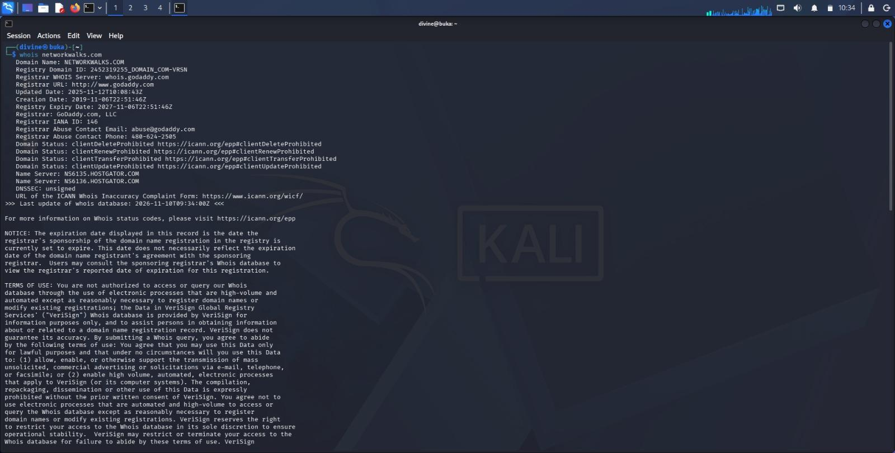

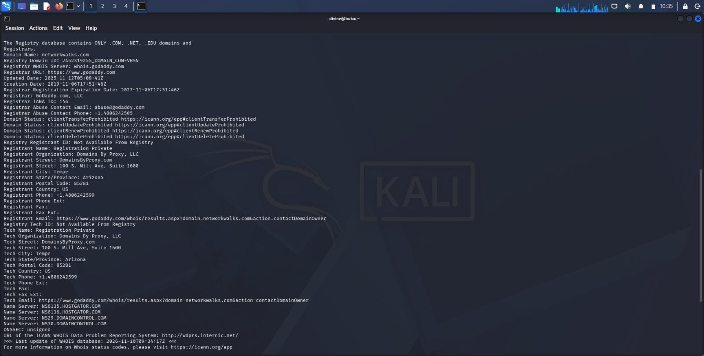

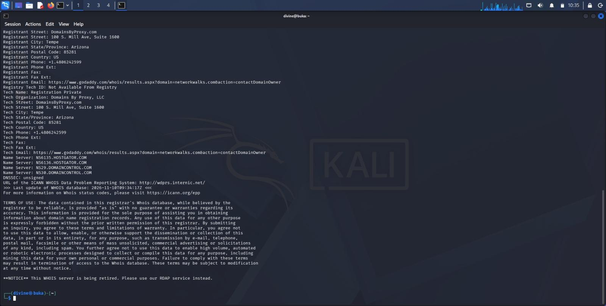

#### WhatWeb: what is the website built with?

```
whatweb networkwalks.com
```

- `http://networkwalks.com` answers with a 301 redirect to `https://networkwalks.com/`.
- The site runs on Apache and WordPress 7.1.4, with the WP Download Manager plugin (3.3.76).
- It also uses jQuery 3.7.1 and Google Tag Manager. The page title is "Networkwalks Academy".
- The server IP shows as `192.232.216.135`.

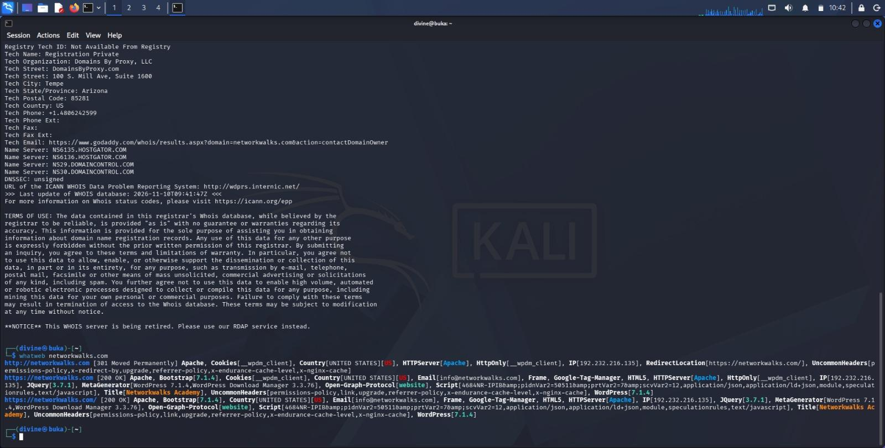

#### nslookup: what IP address does the name point to?

```
nslookup networkwalks.com
```

The answer is `192.232.216.135`, the same IP WhatWeb showed. My first DNS server (8.8.8.8) said recursion was not available, so nslookup tried the next server (`10.182.52.2`) and got the answer there.

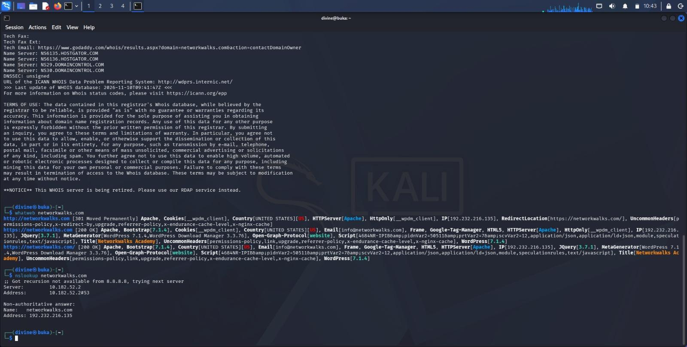

#### curl -I: what do the HTTP headers give away?

```
curl -I https://networkwalks.com
```

- The reply is `HTTP/2 200`, so the site is up.
- `server: Apache` and `x-nginx-cache: WordPress` show the server software.
- The `link` header points to the WordPress REST API at `https://networkwalks.com/wp-json/`.
- A cookie called `__wpdm_client` is set with the `secure` and `HttpOnly` flags.

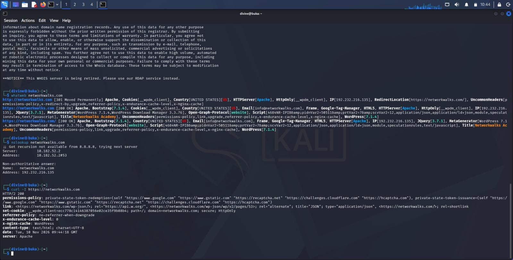

#### wafw00f: is there a firewall in front of the site?

```
wafw00f networkwalks.com
```

The site is behind a ModSecurity (SpiderLabs) Web Application Firewall. wafw00f sent 2 requests to work this out.

My first run had a typo (`networkwalk.com`), and wafw00f said the site "appears to be down". The name did not exist, so the tool could not resolve it. I fixed the spelling and ran it again.

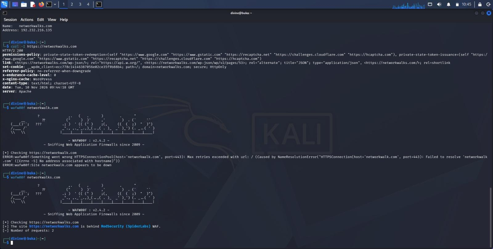

#### DNSRecon: what does the DNS reveal?

```
dnsrecon -d networkwalks.com
```

- The SOA and name servers are `ns6135.hostgator.com` (`50.87.144.87`) and `ns6136.hostgator.com` (`192.232.216.131`). Both report the BIND version `9.16.23-RH`.
- The mail server is `mail.networkwalks.com` at `192.232.216.135`, and the A record is the same IP.
- There is an SPF record: `v=spf1 +a +mx +ip4:50.87.144.87 +include:websitewelcome.com ~all`.
- Eight SRV records point `_autodiscover._tcp` to `cpanelemaildiscovery.cpanel.net`.
- DNSRecon logged "No answer for DNSSEC query", which matches the WHOIS "unsigned" line.

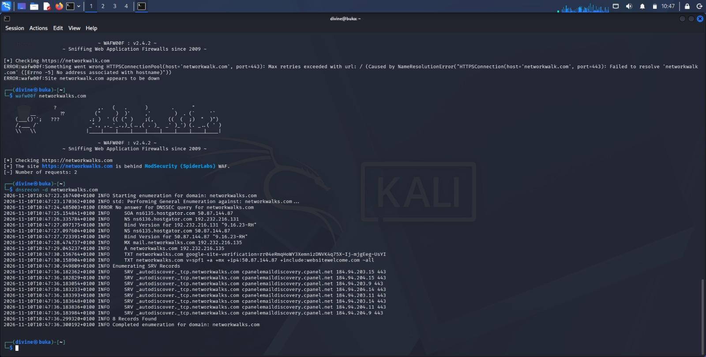

### 4.2 Network Scanning with Zenmap

Zenmap is the graphical version of Nmap. The task was to find my local IP address and subnet, discover the live hosts with a Ping scan, note their IP and MAC addresses, and save the topology as a PDF. I ran Zenmap on my Kali VM on 12 November 2026.

**My Kali VM.** Before scanning I checked the VM from my earlier Kali lab (taken on 29 October 2026). It shows Kali 2026.2, the address `10.0.0.3/24` from DHCP, the default route through `10.0.0.1`, and a working internet check with `ping 8.8.8.8`.

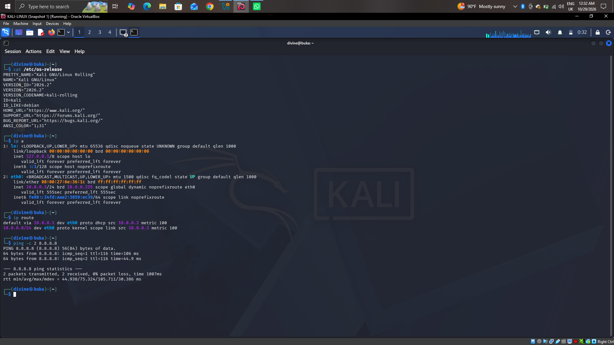

**Step 1: find my IP address and subnet**

```
ifconfig
ip addr
```

`eth0` is `10.0.0.3` with netmask `255.255.255.0`, so my subnet is `10.0.0.0/24`. The MAC address of my VM is `08:00:27:6e:36:1c`.

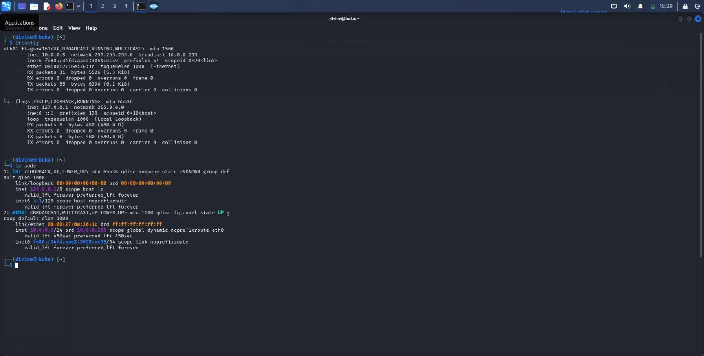

**Step 2: run the Ping scan**

In Zenmap I set the target to `10.0.0.3/24` and the profile to **Ping scan**. Zenmap ran this command:

```
nmap -sn 10.0.0.3/24
```

The scan checked 256 addresses and found 3 hosts up, in 3.03 seconds:

| Host | MAC address | Vendor in Nmap output |
|---|---|---|
| 10.0.0.1 | 52:54:00:12:35:00 | QEMU virtual NIC |
| 10.0.0.2 | 08:00:27:F0:FE:62 | Oracle VirtualBox virtual NIC |
| 10.0.0.3 | (not shown, it is my own VM) | |

`10.0.0.3` is my Kali VM, so no MAC address is listed for it. Its MAC address (`08:00:27:6e:36:1c`) comes from the `ifconfig` output above.

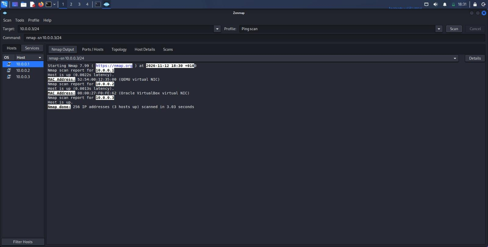

**Step 3: the topology**

On the **Topology** tab, Zenmap draws my VM (`localhost`) in the centre with the three discovered hosts around it.

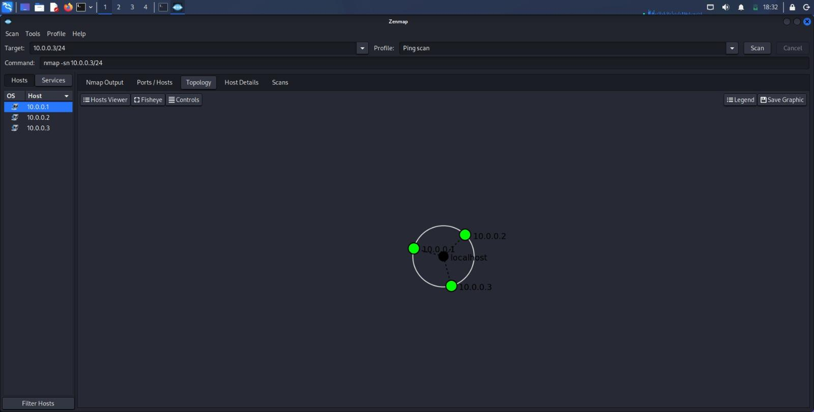

**Step 4: save the topology as a PDF**

I used **Save Graphic** on the Topology tab and chose PDF as the file type.

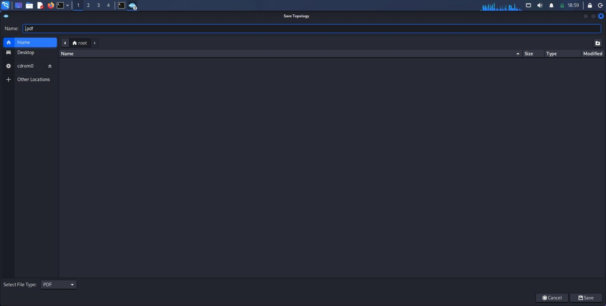

**The lab result.** The Networkwalks quiz for this lab gave me 100%. My answers matched the scan: subnet `10.0.0.3/24`, 3 live hosts (`10.0.0.3`, `10.0.0.2`, `10.0.0.1`), and the three MAC addresses above.

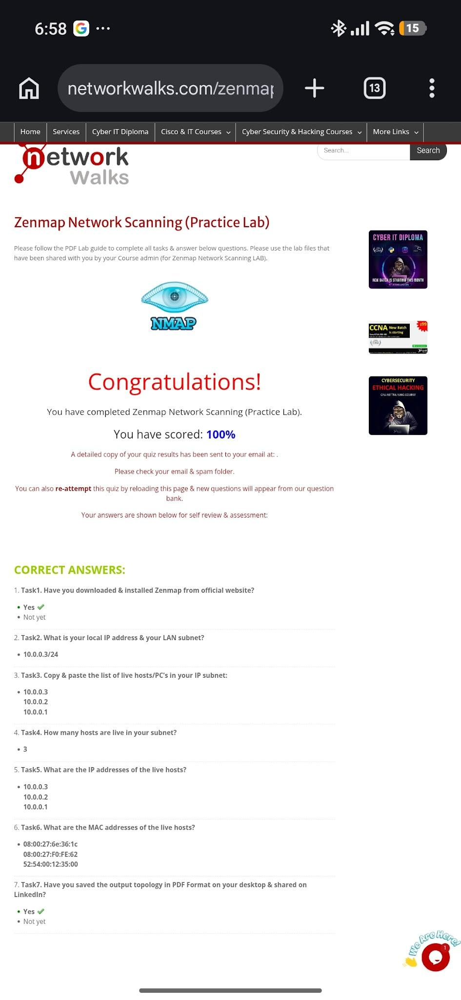

**Scope note.** This scan covered the VirtualBox NAT Network that my VMs sit on, not my home or office Wi-Fi network.

---

## 5. Risk Analysis / Impact

Based on the information collected during the footprinting and scanning activities, I identified the following potential risks.

| # | Risk / Finding | Evidence / Observation | Potential Impact | Risk Level |
|---|---|---|---|---|
| 1 | Web technology and version information exposed | WhatWeb identified WordPress 7.1.4, WP Download Manager 3.3.76, Apache and jQuery 3.7.1 | Attackers may use software names and versions to pick out components that need a security review | ● Medium |
| 2 | Server IP address identifiable | nslookup resolved the domain to `192.232.216.135` | Shows the network location of the web service | ● Low |
| 3 | HTTP technical information exposed | curl -I showed the server software and the `/wp-json/` endpoint in the link header | May help technology fingerprinting and further enumeration | ● Low |
| 4 | WAF technology identifiable | wafw00f identified ModSecurity (SpiderLabs) | Reveals information about the web application's security setup | ● Low |
| 5 | DNS infrastructure information exposed | DNSRecon showed name servers, a BIND version string (9.16.23-RH), the mail host, SPF and SRV records. DNSSEC is unsigned | Helps build a wider picture of the infrastructure; an exposed version string can be matched against known issues | ● Medium |
| 6 | Hosts visible on the local lab network | Zenmap found three live hosts in 10.0.0.0/24 | Unknown devices on a network would stand out in a scan like this; in my lab all three are expected | ● Low |

**Risk level key:** ● Critical  ● Medium  ● Low

The risks above are observations from the footprinting and scanning exercises, not confirmed vulnerabilities. These two activities were information gathering and host discovery only. I did no exploitation and no vulnerability validation. A software version, an IP address or a DNS record does not by itself mean a system is vulnerable. Further authorised testing would be needed to confirm any real weakness.

---

## 6. Recommendations

Based on the observations from these activities, I recommend the following:

1. **Review publicly exposed technology information.** Check what the website reveals about its CMS, plugins and versions, and remove what does not need to be public (for example the generator tag).
2. **Keep software updated.** Update WordPress, plugins and server software regularly and check them against current security advisories.
3. **Review HTTP headers.** Check the response headers and remove any that give away more than needed, such as server details.
4. **Review DNS records regularly.** Check that only the records and services that need to be public are public, and hide DNS software version strings.
5. **Consider enabling DNSSEC.** The domain shows as unsigned. DNSSEC helps protect DNS answers from tampering.
6. **Configure and monitor the WAF.** Keep the WAF (ModSecurity) enabled and tuned, since it already filters simple attacks.
7. **Scan your own network regularly.** Run host discovery on your own networks so you know what devices are active.
8. **Investigate unknown devices.** Check and verify any unexpected device that appears in a scan.
9. **Test only with authorisation.** Reconnaissance and scanning must only be done on systems where permission has been given.

---

## 7. Conclusion

During my Cybersecurity & Ethical Hacking internship I completed two practical activities on footprinting and network scanning.

In the footprinting activity I used six Kali Linux tools against `networkwalks.com`. WHOIS gave the registration details, WhatWeb the web technologies, nslookup the IP address, curl -I the HTTP headers, wafw00f the WAF, and DNSRecon the DNS records.

In the scanning activity I used Zenmap on my Kali VM to find my IP and subnet, discover the three live hosts, collect their MAC addresses and save the topology. Doing this on Kali, with my supervisor's agreement, worked the same way as the Windows setup in the guide.

The main lesson is that a lot can be learned from public information and network replies before any attack is attempted. A good finding in a report should say what was done, what was found, what it means, what risk it creates and how to reduce that risk. Reconnaissance and scanning must always stay inside an authorised scope.

### What went wrong

1. **Typo in wafw00f.** I typed `networkwalk.com` instead of `networkwalks.com`. The tool said the site "appears to be down", which looked like a problem with the site. It was my spelling. If a tool says a site is down, I now check the name first.
2. **Zenmap on Windows.** The lab guide expected Zenmap on a Windows PC. I used Kali instead after asking my supervisor first. I did not assume it was fine to change the setup.

---

## 8. Evidences Collected

The screenshots are stored in the [`screenshots/`](screenshots/) folder and shown in section 4.

| Figure | File | What it shows |
|---|---|---|
| 1 | `01-whois-command.jpg` | WHOIS, registrar summary |
| 2 | `02-whois-full-record.jpg` | WHOIS, full record |
| 3 | `03-whois-name-servers.jpg` | WHOIS, name servers and terms of use |
| 4 | `04-whatweb.jpg` | WhatWeb |
| 5 | `05-nslookup.jpg` | nslookup |
| 6 | `06-curl-headers.jpg` | curl -I |
| 7 | `07-wafw00f.jpg` | wafw00f (first run with my typo, then the correct run) |
| 8 | `08-dnsrecon.jpg` | DNSRecon |
| 9 | `09-kali-vm-check.png` | Kali VM check (29 October 2026) |
| 10 | `10-ifconfig-ip-addr.jpg` | ifconfig and ip addr |
| 11 | `11-zenmap-ping-scan.jpg` | Zenmap Ping scan output |
| 12 | `12-zenmap-topology.jpg` | Zenmap topology |
| 13 | `13-save-topology-pdf.jpg` | Saving the topology as PDF |
| 14 | `14-practice-lab-result.jpg` | Zenmap practice lab result (100%) |

---

## Author

**Ozaraebuka Ifechukwu Divine**  
Cybersecurity Professional B084  
LinkedIn: https://www.linkedin.com/in/ozaraebuka-ifechukwu-7a4b06402

## About me

I am a Computer Science student at the Federal University of Technology, Owerri (FUTO), working towards a career as a SOC analyst. I am doing the Networkwalks Cybersecurity Internship (25 October to 22 November 2026) and keeping a repository for each lab I complete.

## Project Information

**Program Name:** Cybersecurity program at Networkwalks | **Repository:** GitHub  
**Instructor:** Waqas Karim, CCIE

**A note on credit:** the lab tasks and the report format are Networkwalks'. The commands, the screenshots, the findings and this write-up are mine.
